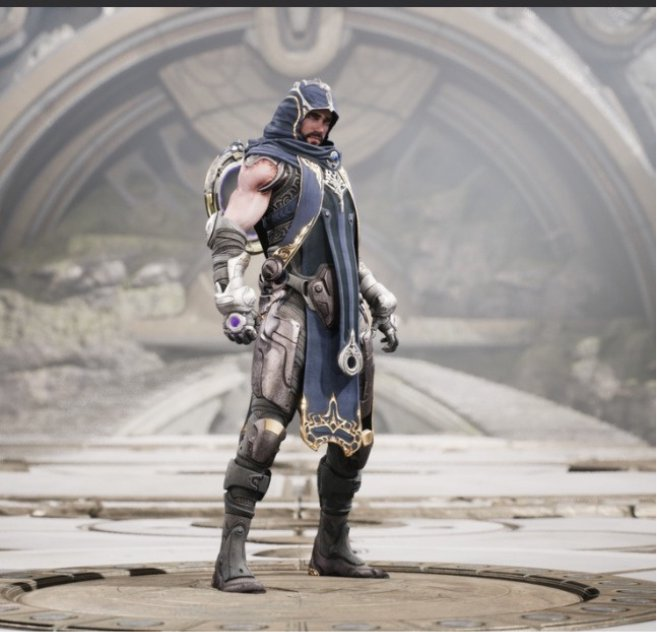

{: .align-center}

Today, we want to introduce the face of our game: **Gideon** (formerly Jax). 

Gideon is a nomad adventurer facing his destiny. For reasons that remain a mystery, he finds himself stranded in an unforgiving desert, called to become the savior of a scorched wasteland ruled by ancient gods.

To understand what lies ahead of him, you have to look at what broke this world:

In the year 2250, an unprecedented cosmic solar storm known as the **"Pulse of Ra"** incinerated power grids across the globe and summoned the pillars of corruption. In Egypt, the ancient pyramids resonated with this strange energy, awakening the Eternal Pharaohs who lay dormant within their depths. They didn't return as men, but as ruthless techno-organic entities that cast a dark curse over the desert—a curse whose deepest secrets you will need to uncover to break it.

From the depths of the ruins, biomechanical warriors now patrol the lost lands, annihilating anyone who dares cross their territory. Every battle leaves behind fragments of energy previously known as the Essence of Ra, now simply called **Mana**—a mystical residue capable of fusing raw scrap metal with arcane power. 

In this new order, crossing the desert is no longer just a journey... it is an open declaration of war against ancient gods who refuse to be defied.

Stay tuned as we share more about Gideon's abilities, weapons, and journey in the coming devlogs.
