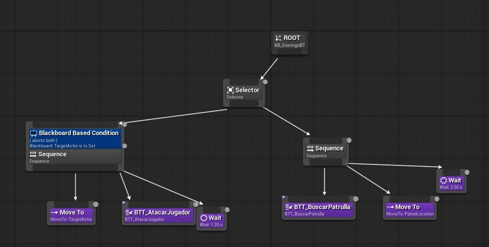

{: .align-center}

To bring the world of Dust Punk to life in Unreal Engine 5.6, we recently focused on tying together our enemy AI, boss encounters, and story interactions into one fluid experience. 

For our wandering wasteland enemies, we set up a Behavior Tree system paired with Unreal's AI Perception. While left alone, enemies simply pick random navigable spots across the desert sand and patrol on their own. The moment you cross their sight line, the perception sensor immediately overrides their patrol, locks onto you as the target, and shifts them into an aggressive pursuit and combat loop.

That same combat foundation steps up a notch once you clear the pyramid's puzzle chambers and enter the arena against the final boss, Khaimera. Instead of standard wandering, Khaimera stays locked onto your position at all times, alternating between close-quarters melee swings and a heavy leap attack if you try to back away. We also hooked up an on-screen boss health bar, mid-fight dialogue barks, and a dedicated defeat sequence once you finish the battle.

To tie the exploration together, friendly NPCs help guide your progression between the open desert and the pyramid. We put together an interactive dialogue UI that plays nice with both gamepad and keyboard/mouse setups. Talking to Serath, the Pharaoh, checks what you have unlocked so far—like discovering keys or speaking with other travelers—and rewards you by replenishing and expanding your health and mana vials. Once you wrap up your talk with her at the end of the trials, a cinematic sequence takes over with camera cuts and visual effects, transporting you out of the pyramid and safely back to the Oasis.

It really feels like all the pieces of the puzzle are coming together into a solid adventure. More updates coming soon.
