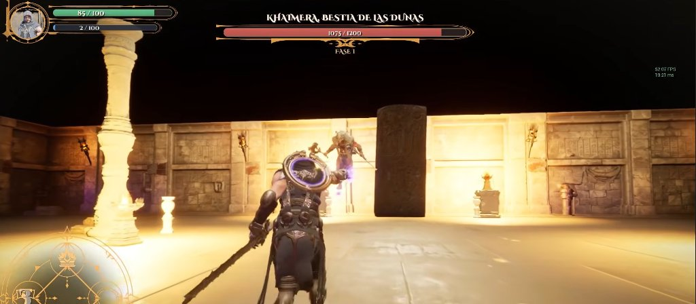

{: .align-center}

We're getting really close to launch, and honestly, the whole team is pretty excited to finally put this out there.

A lot has come together over the past few months. In this upcoming build, you can expect environmental puzzles, in-engine cinematics, character abilities and powers, and plenty of combat features to experiment with. You can see a quick preview above of an active boss encounter in the ruins.

Keep in mind that this release is an Alpha. While it offers a solid slice of gameplay, it's an early build as we continue developing toward the full 1.0 release. 

More than anything, we're genuinely eager to hear what you think once you get to play it. Your feedback will help us dial in the combat, balance the puzzles, and polish the experience.

Stay tuned, the wait is almost over.
